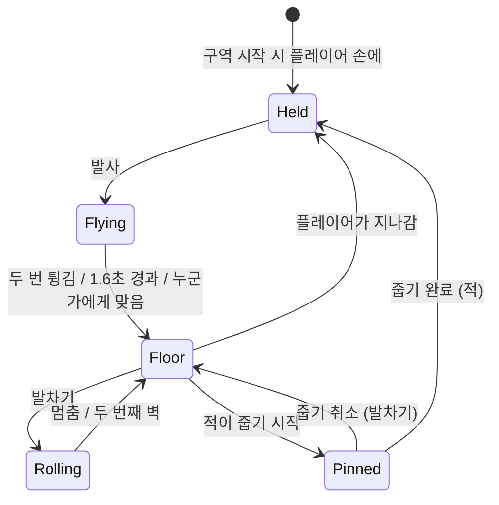
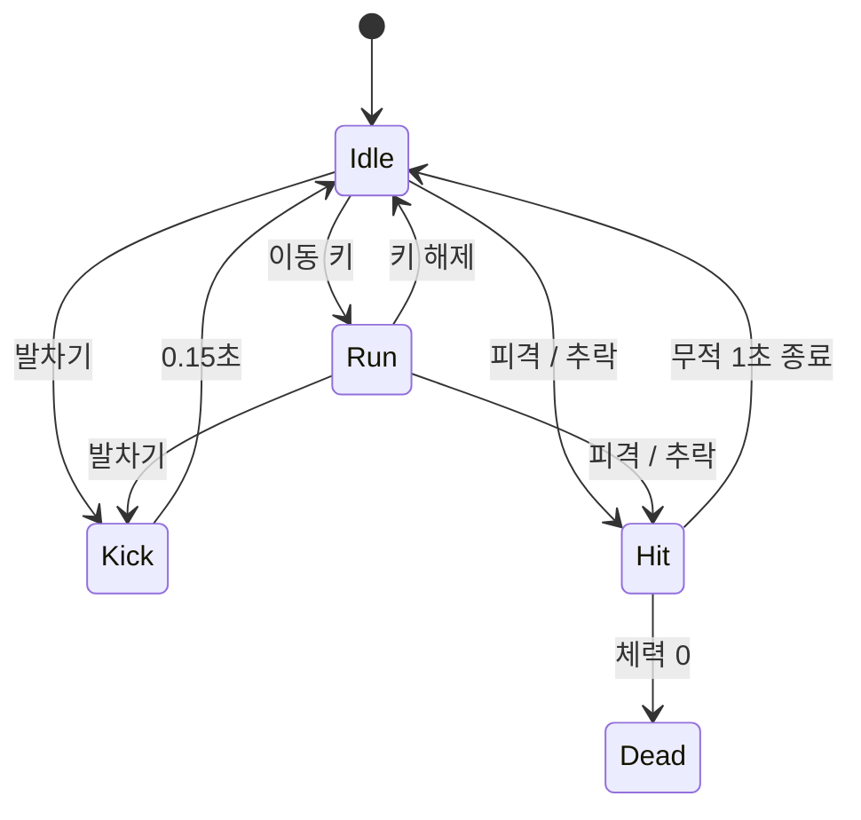
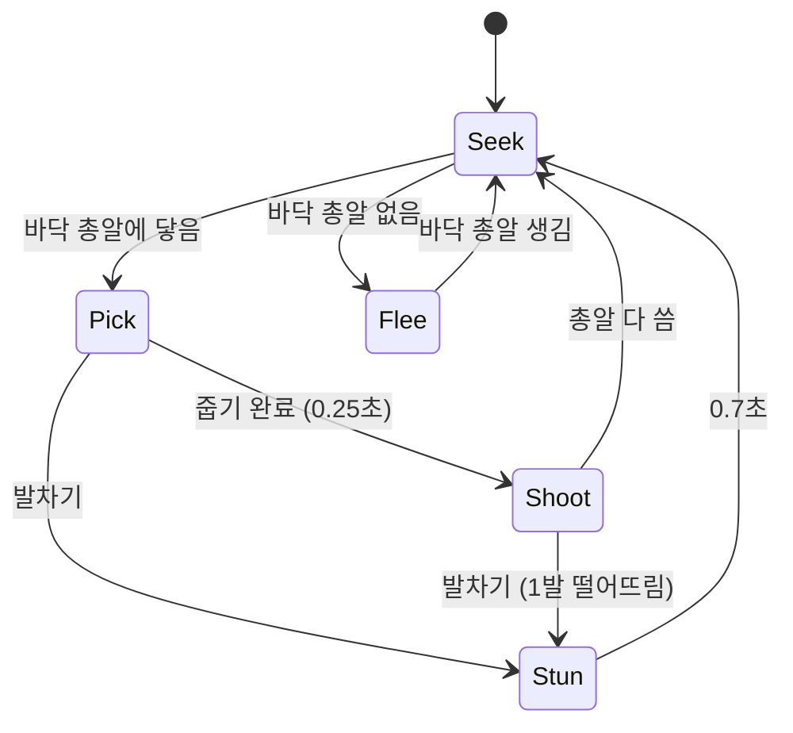
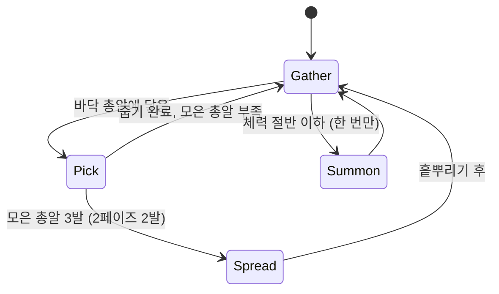
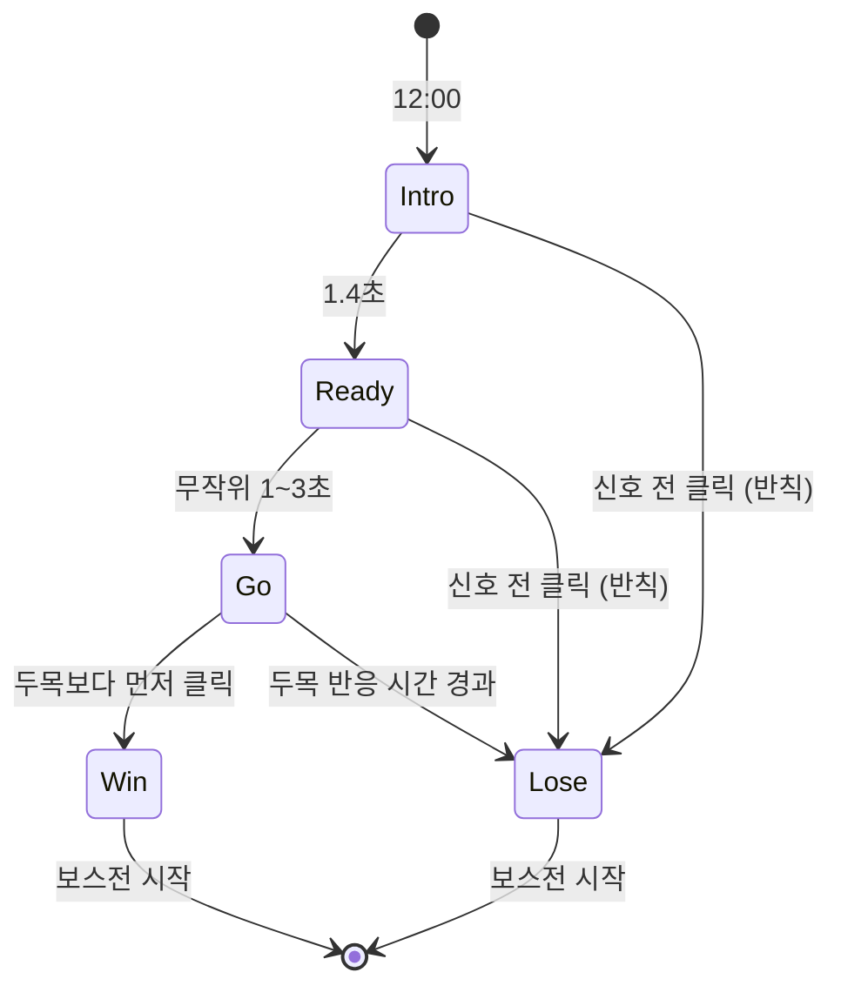

# Last 6 Bullet 게임 기획서

> 총알이 여섯 발뿐인 무법 마을. 내가 빗맞힌 한 발은 곧 무법자의 탄약이 된다.

- 과목: 2D 게임 프로그래밍 (2026-2학기)
- 개발: 2023148012 손세민 (1인 개발, Python, pico2d)
- 문서 상태: 1차 발표용 초안. 수치는 브라우저 체험판으로 확인한 초기값이다.

---

## 1. 게임 개요

| 항목 | 내용 |
|---|---|
| 게임명 | Last 6 Bullet |
| 장르 | 탑뷰 아레나 액션 슈팅 |
| 개발 환경 | Python 3.13, pico2d 1.5.1 |
| 플랫폼 | Windows PC, 키보드와 마우스 |
| 플레이 | 싱글 플레이, 구역 단위 전투 |
| 배경 | 총알이 바닥난 서부 무법 마을 |
| 목표 | 술집, 광산, 달리는 기차, 은행 4구역을 돌파하고 은행의 무법자 두목을 쓰러뜨린다 |
| 개발 규모 | 4구역, 적 3종 + 보스 1, 업그레이드 6종 |
| 개발 기간 | 4주 |

## 2. 기획 의도

슈팅 게임에서 총알은 보통 무한하거나, 줍기만 하면 되는 소모품이다. 이 게임은 **총알 한 발 한 발에 무게를 주는 것**에서 출발했다.

구역 안에 존재하는 총알 수를 고정하고, 그 총알을 플레이어와 적이 함께 쓰게 했다. 쏜 총알은 사라지지 않고 바닥에 떨어지며, 그 총알을 누가 먼저 줍느냐에 따라 전투의 흐름이 바뀐다. 그래서 플레이어는 쏘는 순간마다 "빗나가면 적에게 준다"는 부담을 안고, 바닥의 총알을 두고 적과 달리기 경쟁을 한다.

리볼버는 원래 6연발이라 "총알 여섯 발"이라는 제약이 서부극 배경에서 자연스럽다.

## 3. 핵심 규칙: 공유 총알

1. **구역 안의 총알 수는 고정이다.** 기본 6발이며 구역에 따라 4~6발로 바뀐다. 내 손, 바닥, 공중, 적의 손에 있는 총알을 모두 더하면 항상 같은 수다.
2. **쏜 총알은 벽과 장애물에 최대 두 번 튕긴 뒤 바닥에 떨어진다.** 적에게 맞아도 그 자리에 떨어진다.
3. **바닥 총알은 지나가면 줍는다.** 플레이어는 즉시 줍고, 적은 짧은 줍기 동작(0.25초)이 필요하다.
4. **적도 바닥 총알을 줍는다.** 주운 총알로 플레이어를 쏘거나(줍줍이), 삼켜서 숨긴다(들개).
5. **벽에 튕긴 총알은 누구든 맞는다.** 내가 쏜 총알도 튕기면 나를 맞히고, 적이 쏜 총알도 튕기면 쏜 적 자신과 다른 적을 맞힌다. 아무 데나 쏘면 위험하고, 반대로 적이 장애물 쪽으로 쏘게 유도하면 적끼리 맞게 만들 수도 있다.

## 4. 핵심 루프

```
 쏜다 ──▶ 맞히면 적이 쓰러지고 총알은 그 자리에 떨어진다
   │       빗나가면 튕긴 뒤 바닥에 떨어진다
   ▼
 바닥 총알 쟁탈 ──▶ 내가 먼저 주움 ──▶ 다시 쏜다
   │
   └──▶ 적이 주움 ──▶ 발차기로 빼앗기 / 피하면서 되찾기
```

한 구역은 1~2분 안에 끝나는 짧은 전투이고, 구역을 클리어하면 오른쪽 문으로 다음 구역에 들어간다.

## 5. 조작

| 입력 | 동작 |
|---|---|
| W A S D | 8방향 이동 |
| 마우스 이동 | 조준 (캐릭터가 마우스 방향을 바라봄) |
| 마우스 왼쪽 클릭 | 발사 |
| Space 또는 마우스 오른쪽 클릭 | 발차기 |

## 6. 발차기

총알이 없어도 쟁탈전에 참여할 수 있게 하는 보조 행동이다. **데미지는 없다.**

- 누르는 즉시 조준 방향 앞쪽 부채꼴(반경 약 50px)을 찬다. 쿨타임 0.65초.
- **적을 밀친다.** 차인 적은 뒤로 밀려나고 0.7초 기절한다.
- **총알을 떨어뜨리게 한다.** 총알을 가진 적을 차면 1발을 떨어뜨린다.
- **줍기를 끊는다.** 적이 줍는 동작 중에 차면 줍기가 취소된다.
- **바닥 총알을 굴린다.** 찬 총알은 조준 방향으로 굴러가다 마찰로 멈춘다. 벽에 한 번 튕기면 속도가 절반이 되고, 두 번째 벽에서 멈춘다. 벽에 붙은 총알도 꺼낼 수 있다.

급박한 상황에서 쓰는 기술이라 굴러갈 경로 미리 보기는 넣지 않는다. 정밀함은 사격에 맡기고 발차기는 빠르고 단순하게 둔다.

## 7. 구역 구성

구역마다 총알을 다루는 규칙이 하나씩 바뀐다.

| 구역 | 구역 규칙 | 플레이 포인트 | 총알 |
|---|---|---|---|
| 01 술집 | 테이블에도 총알이 튕긴다 | 튕김과 줍기의 기본을 익힌다. 테이블 뒤로 숨거나 튕김 각도를 노린다 | 6발 |
| 02 광산 | 어두워서 랜턴 빛(반경 약 110px) 안의 바닥 총알만 보인다. 바깥 총알은 가끔 반짝인다 | 빛을 들고 총알을 찾으며 줍줍이와 경쟁한다 | 5발 |
| 03 달리는 기차 | 열차 바닥에서는 총알이 빠르게(70px/s), 사람이 천천히(플레이어 28px/s, 적 14px/s) 뒤로 밀린다 | 총알은 뒤쪽 짐받이 턱에 모인다. 그 뒤 위험 띠에서는 평소에 밀리지 않지만, 덜컹(5~7초 간격, 1초 전 예고)이 오면 크게 밀려 떨어질 수 있다. 턱 근처 적은 발차기로 떨어뜨릴 수 있다 | 6발 |
| 04 은행 | 정오의 결투로 시작하는 보스전 | 결투 결과로 총알 배분이 정해진다 | 6발 |

기차에서 떨어지면 플레이어는 체력 1을 잃고 열차 가운데로 돌아온다. 적은 퇴장하며 가진 총알을 턱 앞에 흘린다. 총알 수는 유지된다.

## 8. 수배자 (적)

새로운 적이 처음 등장하면 **현상수배 포스터**가 화면에 붙으며 이름, 현상금, 특징, 약점을 알려 준다. 튜토리얼 대신 쓰는 연출이며, 본 포스터는 마을 게시판에서 다시 볼 수 있다.

| 수배자 | 현상금 | 행동 | 약점 | 체력 |
|---|---|---|---|---|
| 줍줍이 | $50 | 바닥 총알을 주워서 거리를 두고 쏜다. 총알이 없으면 도망친다 | 줍는 동안 발차기, 쓰러뜨리면 가진 총알을 떨어뜨림 | 1 |
| 술꾼 | $30 | 플레이어에게 돌진해 몸으로 부딪힌다 | 발차기로 밀어내기, 두 발이 필요 | 2 |
| 들개 | $20 | 빠르게 달려가 바닥 총알을 삼킨다. 쏘지는 않는다 | 차면 삼킨 총알을 토해 냄 | 1 |
| 두목 | $500 | 보스. 아래 9장 참고 | 총알을 모으기 전에 먼저 줍기 | 8 |

적은 플레이어의 이동 방향을 예측해서 쏜다(난이도에 따라 예측 정도가 다름).

## 9. 보스: 은행의 두목

### 정오의 결투 (보스 등장)

1. 은행에 들어서면 음악이 멈추고 시계탑이 12시를 친다. 보안관과 두목이 마주 선다.
2. "준비…" 문구가 1~3초 중 무작위 시간 동안 떠 있다가 "쏴!" 신호가 뜬다.
3. 신호 뒤 두목(반응 0.3~0.45초)보다 먼저 클릭하면 승리한다. 신호 전에 누르면 반칙으로 패배한다.

| 결과 | 보스전 시작 조건 |
|---|---|
| 승리 | 두목 체력 -1, 총알 6발 모두 플레이어 손에 |
| 패배 | 플레이어 체력 -1, 총알을 3발씩 나눠 쥐고 시작 (두목이 바로 흩뿌리기) |

결투는 연출에 그치지 않고 핵심 규칙인 총알 배분과 연결된다. 결투는 보스 등장 때 한 번만 한다.

### 보스 패턴

- **1페이즈:** 바닥 총알을 3발 모으면 부채꼴로 한꺼번에 흩뿌린다. 총알을 모으는 중에는 줍기 동작이 있어 발차기로 끊을 수 있다. 차면 1발씩 떨어뜨린다.
- **2페이즈 (체력 절반 이하):** 휘파람으로 부하 줍줍이 2명을 부른다. 방 안의 총알은 그대로인데 노리는 적이 셋으로 늘어난다. 두목은 2발만 모여도 흩뿌린다.

## 10. 진행, 승패, 평가

- **체력:** 보통 난이도 기준 4. 구역 사이에 회복하지 않는다. 0이 되면 게임 오버.
- **클리어:** 은행의 두목을 쓰러뜨리면 마을을 되찾고 엔딩.
- **현상금:** 쓰러뜨린 수배자의 현상금이 점수가 된다.
- **구역 평가:** 클리어 시간, 피격 횟수, 빼앗긴 총알 수로 별 1~3개를 준다.
- **보안관 배지 (업그레이드):** 구역을 클리어할 때마다 3개 중 1개를 고른다.

| 배지 | 효과 |
|---|---|
| 자석 박차 | 총알 줍는 범위 증가 |
| 철 부츠 | 발차기 기절 시간 증가 |
| 은탄 | 쏜 총알이 한 번 더 튕김 |
| 빠른 손 | 적의 줍기 동작 시간 증가 |
| 보안관의 눈 | 어두운 곳에서도 바닥 총알이 보임 |
| 마지막 의지 | 손에 마지막 1발만 남았을 때 그 총알의 데미지 2배 |

## 11. 난이도 설계

난이도는 체력이나 데미지보다 **총알 쟁탈전의 빡빡함**으로 조절한다. 기본 난이도는 보통이다.

| 항목 | 쉬움 | 보통 | 어려움 |
|---|---|---|---|
| 플레이어 체력 | 5 | 4 | 3 |
| 적 줍기 동작 | 0.35초 | 0.25초 | 0.2초 |
| 발차기로 떨어뜨리는 총알 | 가진 것 전부 | 1발 | 1발 |
| 발차기 쿨타임 | 0.45초 | 0.65초 | 0.8초 |
| 적 조준 예측 | 없음 | 일부 | 완전 |
| 광산 총알 수 | 6발 | 5발 | 4발 |
| 구역당 적 수 | 3 | 3~4 | 4~5 |
| 두목 체력 | 6 | 8 | 10 |
| 결투 두목 반응 | 0.4~0.6초 | 0.3~0.45초 | 0.25~0.38초 |

## 12. 재미 요소

- **한 발의 무게:** 빗맞힌 총알이 적의 탄약이 되므로 쏘는 순간마다 판단이 생긴다.
- **바닥 총알 쟁탈전:** 떨어진 총알을 두고 적과 달리기 경쟁을 하는 장면은 다른 슈팅 게임에 없는 긴장감이다.
- **공격, 방어, 탈환이 하나의 자원으로 이어짐:** 총알로 공격하고, 발차기로 적의 줍기를 끊고, 쓰러뜨려 되찾는다.
- **구역마다 바뀌는 총알 규칙:** 튕김, 어둠, 미끄러짐, 결투로 같은 규칙을 매번 다르게 쓴다.
- **극적인 순간:** 마지막 한 발로 역전하기, 정오의 결투, 기차에서 적을 차서 떨어뜨리기.

## 13. 차별성

비슷한 게임을 조사한 결과는 다음과 같다.

| 요소 | 비슷한 게임 | 이 게임 |
|---|---|---|
| 쏜 총알을 주워 다시 쓰기 | Heavy Bullets (2014, 1인칭, 6발 회수) | 같은 출발점 |
| 적이 탄약을 가져감 | Enter the Gungeon (방을 나가면 쥐가 바닥 아이템을 가져감), Do Not Miss (적이 보관함 탄약을 훔침) | 전투 중에 적이 **내가 쏜 총알**을 주워 **나에게 쏜다** |
| 서부극 탑뷰 슈팅 | 12 Is Better Than 6, Kill The Crows 등 | 배경일 뿐 차별점으로 내세우지 않음 |
| 구역 안 총알 수 고정, 플레이어와 적이 공유 | 조사 범위에서 찾지 못함 | **핵심 차별점** |

정리하면, 총알을 주워 쓰는 게임은 이미 있다. 이 게임은 그 총알을 적도 주워 쓰게 하고, 구역 안의 총알 수를 고정해서 **하나의 자원을 두고 벌이는 쟁탈전**으로 만들었다.

## 14. 그래픽과 사운드 방향

- **시점:** 탑뷰. 맵은 비스듬히 내려다본 듯한 분위기의 배경 이미지, 캐릭터와 총알은 바로 위에서 본 이미지를 사용한다.
- **캐릭터:** 위에서 본 이미지 한 장을 마우스 방향으로 회전시켜 그린다(`composite_draw`). 방향별 애니메이션을 따로 만들지 않아 작업량을 줄인다.
- **이미지 제작:** 캐릭터, 수배 포스터 초상화, 구역 배경은 AI 이미지 생성 도구로 만든다. 같은 프롬프트 문구와 색감을 써서 스타일을 맞춘다.
- **총알 구분:** 내 총알, 적 총알, 튕긴 총알, 바닥 총알을 색과 모양으로 구분한다.
- **사운드:** 총성, 총알이 떨어지는 소리, 주울 때 "철컥" 장전 소리, 정오의 종소리, 기차 덜컹 소리. 무료 효과음 또는 생성 음원을 쓴다.

## 15. 기술 설계

수업에서 다룬 pico2d 구조(`game_framework`의 모드 전환, `game_world`의 레이어와 충돌 쌍, 상태 머신)를 그대로 따른다.

### 15-1. 화면 흐름

```
 타이틀 ──▶ 구역 진행(술집 → 광산 → 기차) ──▶ 정오의 결투 ──▶ 은행 보스전 ──▶ 엔딩
              │   ▲                                              │
              ▼   │ 닫기                                         │
           수배 포스터 (첫 등장 시 위에 겹쳐 표시)                 │
              │                                                  │
              └──────── 체력 0 ──▶ 게임 오버 ──▶ 타이틀 ◀──────────┘
 구역 클리어 후 배지 선택 화면을 거쳐 다음 구역으로 간다.
```

| 모드 | 화면 내용 |
|---|---|
| `title_mode` | 제목, 시작과 난이도 선택 |
| `play_mode` | 구역 전투. 체력, 손에 든 총알, 구역 이름 표시 |
| `poster_mode` | `play_mode` 위에 겹치는 수배 포스터. 클릭 또는 1.5초 후 닫힘 |
| `badge_mode` | 구역 클리어 후 보안관 배지 3개 중 1개 선택 |
| `duel_mode` | 정오의 결투. 결과를 `play_mode`에 넘겨 보스전 시작 조건을 정함 |
| `ending_mode` / `gameover_mode` | 현상금 합계, 구역 평가, 재시작 안내 |

### 15-2. 파일 구성

수업 예제처럼 모드와 객체 파일을 프로젝트 루트에 둔다.

```
last_six/
├── main.py              # 진입점
├── game_framework.py    # 모드 전환과 메인 루프
├── game_world.py        # 레이어, 충돌 쌍
├── config.py            # 난이도별 수치 (체험판 초기값)
├── title_mode.py  play_mode.py  poster_mode.py  badge_mode.py
├── duel_mode.py   ending_mode.py  gameover_mode.py
├── player.py            # 보안관
├── bullet.py            # 총알 (상태로 비행, 바닥, 굴러감 관리)
├── enemy.py             # 적 공통 (줍기, 기절, 소지 총알)
├── picker.py  drunk.py  dog.py  boss.py
├── zone.py              # 구역 규칙(튕김, 어둠, 미끄러짐), 장애물, 문
├── ammo_ledger.py       # 구역 총알 수 검증
├── hud.py               # 체력, 총알, 덜컹 예고 표시
├── tools/               # 자동 점검(check.py), 스크린샷(shot.py)
└── res/                 # 이미지, 효과음
```

상태 머신은 수업(LEC12~15)과 같이 `transitions` 라이브러리의 `Machine`을 각 클래스에 붙여 쓴다. 처음 계획한 `state_machine.py`는 만들지 않는다 (1주차에 변경).

### 15-3. 주요 클래스

| 클래스 | 역할 |
|---|---|
| `Player` | 이동, 마우스 조준, 발사, 발차기, 체력과 무적 시간, 손에 든 총알 수 |
| `Bullet` | 구역 안 총알 한 발. 상태에 따라 날아가고, 떨어지고, 굴러가고, 누군가의 손에 들림 |
| `Enemy` | 적 공통 부모. 가까운 바닥 총알 찾기, 줍기 동작, 기절, 쓰러질 때 총알 떨어뜨리기 |
| `Picker` / `Drunk` / `Dog` | 줍줍이, 술꾼, 들개. `Enemy`를 상속하고 행동만 다름 |
| `Boss` | 두목. 총알 모으기와 흩뿌리기, 2페이즈 부하 호출 |
| `Zone` | 구역 데이터(장애물 배치, 총알 수, 구역 규칙)와 매 프레임 구역 효과(어둠, 밀림, 덜컹) |
| `AmmoLedger` | 매 프레임 플레이어, 바닥, 공중, 적이 가진 총알을 합산해 구역 총알 수와 다르면 경고 |

### 15-4. 상태 설계

수업의 상태 머신 패턴으로 각 객체의 상태를 나눈다. 아래 값은 모두 체험판 초기값이다.

#### 총알 (`Bullet`)

이 게임에서 가장 중요한 객체다. 총알 한 발은 항상 아래 상태 중 하나에 있다.



| 상태 | 동작 |
|---|---|
| Held | 그리지 않음. 소유자(플레이어 또는 적)의 총알 수로만 셈 |
| Flying | 520px/s로 직진, 벽과 장애물에 반사 |
| Floor | 바닥에 놓임. 기차 구역에서는 뒤로 미끄러짐 |
| Rolling | 발차기로 굴러감. 마찰로 감속, 벽 한 번 튕기면 속도 절반 |
| Pinned | 적이 밟고 줍는 중. 미끄러지지 않음 |

#### 플레이어 (`Player`)



발사는 상태를 바꾸지 않는 즉시 행동으로 처리한다. Hit 상태에서도 이동과 발사는 가능하다.

#### 줍줍이 (`Picker`)



- **술꾼:** Charge(돌진) ↔ Stun 두 상태만 가진다.
- **들개:** Seek → Pick → Seek(삼킨 총알은 쏘지 않고 보관), 발차기에 맞으면 Stun 상태로 가며 삼킨 총알을 토해 낸다.

#### 두목 (`Boss`)



#### 정오의 결투 (`duel_mode`)



### 15-5. 충돌 처리

수업 방식대로 각 객체가 `get_bb()`로 사각형 경계를 돌려주고, `game_world`에 충돌 쌍을 등록해 `handle_collision()`에서 처리한다.

| 충돌 쌍 | 처리 |
|---|---|
| 내 총알(Flying) : 적 | 적 체력 -1, 총알은 Floor |
| 적 총알(Flying) : 플레이어 | 플레이어 체력 -1, 총알은 Floor |
| 튕긴 총알 : 플레이어, 적 | 누가 쏜 총알이든 피해 (쏜 본인 포함) |
| 총알(Flying, Rolling) : 장애물, 벽 | 겹친 깊이가 얕은 축의 속도를 뒤집어 반사 |
| 바닥 총알 : 플레이어 | 즉시 줍기 |
| 바닥 총알 : 적 | 줍기 동작 시작 (Pinned) |
| 술꾼, 들개, 두목 : 플레이어 | 플레이어 체력 -1 |
| 발차기 판정 박스 : 적, 바닥 총알 | 조준 방향 앞에 0.15초 동안 사각형 판정 박스를 만들어 처리 |

### 15-6. 구현할 때 주의할 점 (체험판에서 발견)

- 움직이는 바닥(기차) 위에서는 적이 줍는 동안 총알이 미끄러져 멀어져 줍기가 실패한다. 줍는 동안 총알을 Pinned 상태로 고정한다.
- 기차 구역에서는 총알이 멈추는 위치(짐받이 턱)와 사람이 떨어지는 위치(위험 띠 끝)를 분리해야 총알을 주우러 갈 수 있다.
- 튕긴 총알은 쏜 적 자신도 맞기 때문에, 적이 벽 가까이에서 쏘면 저절로 쓰러질 수 있다. 플레이 테스트에서 적이 자멸하는 빈도를 확인한다.

**검증 방식:** AI가 생성한 코드는 그대로 쓰지 않고 명세 → 코드 검토 → 실행 → 테스트 → 설명 순서로 확인한 뒤 커밋한다.

## 16. 개발 범위

| 구분 | 내용 |
|---|---|
| 필수 | 공유 총알 규칙, 사격과 반사, 줍기, 발차기, 4구역, 적 3종, 보스(결투 + 2페이즈), 체력과 게임 오버, 현상수배 포스터 |
| 추가 (여유가 있으면) | 보안관 배지 6종, 구역 평가 별, 마지막 한 발 연출, 난이도 선택 |
| 제외 | 무기 추가, 총알 종류 추가, 구역 추가, 멀티플레이 |

일정이 밀리면 추가 항목을 뒤에서부터 뺀다. 그래도 부족하면 광산 구역의 어둠 효과를 단순화한다.

## 17. 개발 일정

1~3주차는 도형(원, 사각형)으로 개발하고 4주차에 AI 이미지로 교체한다. 각 주차의 마지막 날은 그 주에 만든 기능을 실행해서 확인하고 커밋하는 날로 비워 둔다.

### 1주차: 뼈대와 공유 총알

- [x] `game_framework`, `game_world`, `config.py` 구성 (상태 머신은 `transitions` 사용)
- [x] 플레이어 이동, 마우스 조준, 발사
- [x] 총알 상태(Held, Flying, Floor)와 벽, 장애물 반사
- [x] 바닥 총알 줍기, 튕긴 총알 자해와 체력 표시
- [x] `AmmoLedger`로 구역 총알 수 합계 디버그 표시 (F1)

진행 기록: [docs/DEVLOG.md](docs/DEVLOG.md)

### 2주차: 적과 발차기, 첫 두 구역

- [ ] `Enemy` 공통 클래스와 줍기 동작(Pinned)
- [ ] 줍줍이, 술꾼, 들개 상태 머신
- [ ] 발차기(밀치기, 기절, 총알 떨어뜨리기, 굴리기)
- [ ] 술집, 광산(어둠) 구역과 구역 전환
- [ ] 체력, 피격 무적, 게임 오버

### 3주차: 기차와 보스

- [ ] 기차 구역(밀림, 짐받이 턱, 위험 띠, 덜컹 예고)
- [ ] `duel_mode` 정오의 결투와 결과 전달
- [ ] 두목 1페이즈(모으기, 흩뿌리기), 2페이즈(부하 호출)
- [ ] 엔딩

### 4주차: 그래픽과 마무리

- [ ] AI 이미지로 보안관, 적 3종, 두목, 구역 배경 제작 후 교체
- [ ] 현상수배 포스터(`poster_mode`), 타이틀
- [ ] 효과음
- [ ] 난이도별 수치 조정, 버그 수정
- [ ] 여유가 있으면 보안관 배지, 구역 평가

## 18. 위험 요소와 대응

| 위험 요소 | 영향 | 대응 |
|---|---|---|
| 버그로 총알이 늘어나거나 사라짐 | 핵심 규칙이 깨지고 게임이 막힐 수 있음 | `AmmoLedger`가 매 프레임 합계를 검사하고 다르면 화면에 경고. 총알 객체는 구역 시작 때만 만들고 이후에는 상태만 바꿈 |
| 빠른 총알(520px/s)이 얇은 장애물을 뚫고 지나감 | 반사가 안 되고 벽 밖으로 나감 | 장애물과 벽 두께를 한 프레임 이동 거리보다 두껍게 만들고, 부족하면 한 프레임을 나눠 여러 번 이동 판정 |
| 적이 장애물 모서리에 걸려 멈춤 | 쟁탈전이 일어나지 않음 | 장애물에서 밀어내기 처리, 장애물을 단순한 직사각형으로 배치 |
| 적이 자기가 쏜 튕긴 총알에 자주 쓰러짐 | 의도보다 쉬워짐 | 플레이 테스트로 자멸 빈도를 확인하고, 많으면 적이 벽 쪽을 향해 쏘지 않도록 조준을 제한한다. 그래도 많으면 적 총알이 적을 통과하게 바꾼다 |
| 난이도가 너무 쉽거나 어려움 | 재미 감소 | 수치를 `config.py`에 난이도별로 모아 두고 11장 표를 기준으로 플레이 테스트하며 조정 |
| AI 이미지의 스타일과 크기가 제각각 | 완성도 저하, 판정과 그림 불일치 | 같은 프롬프트 문구 사용, 판정 크기는 이미지와 별도로 `config.py`에서 관리. 실패하면 도형을 다듬어 사용 |
| 4주 일정이 빠듯함 (특히 3주차) | 미완성 | 1~2주차에 공유 총알과 줍기를 먼저 완성. 16장의 추가 항목은 뒤에서부터 제외 |
